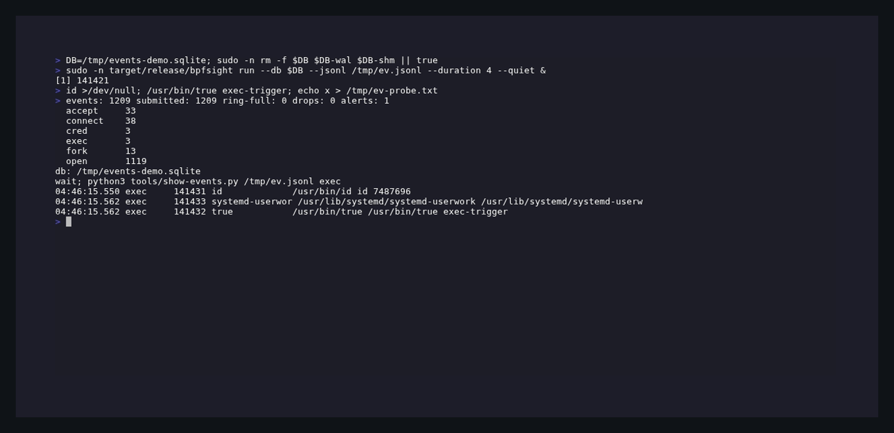
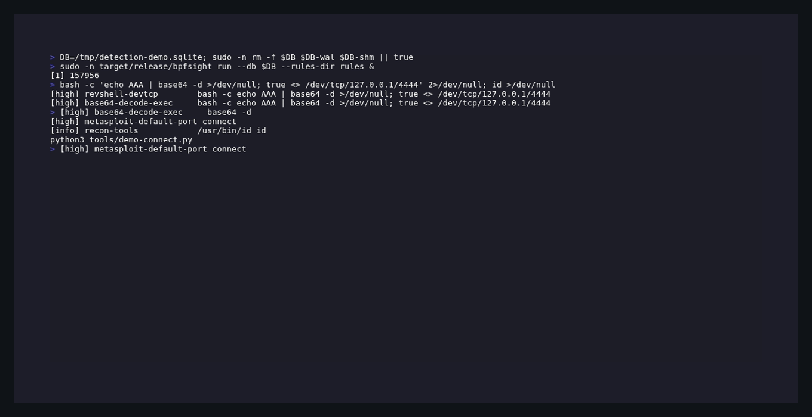
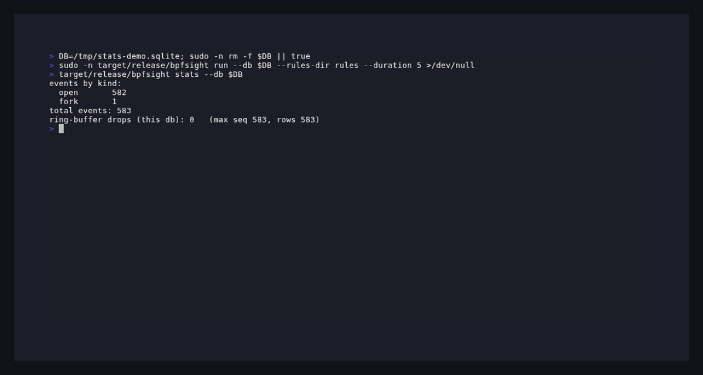
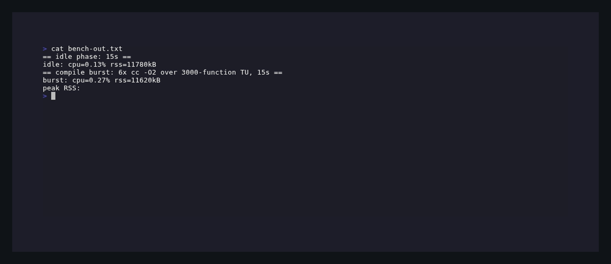
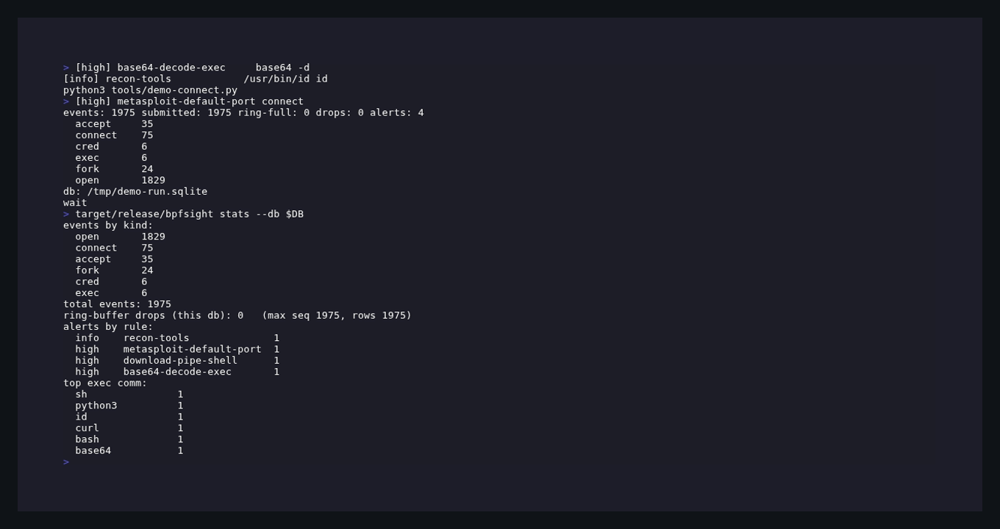

# bpfsight

eBPF host sensor for Linux: streams process, file, network, credential and
module events from the kernel into JSONL + SQLite and matches them against a
built-in detection engine, live. One binary, no daemons, no external services.

- 7 event kinds: `exec` (with argv), `fork`, `connect`, `accept`, `open` (with
  full open flags), `cred` (uid transitions), `module` (kernel module loads)
- 14 built-in detections + sigma-style YAML rules + IOC list matching
- JSONL + SQLite sinks, drop accounting (ring-buffer losses never go unnoticed)
- `stats` subcommand for capture accounting after the fact
- overhead: 0.13% of one core idle, 0.27% under a 6-way compile burst, ~11.7 MB RSS (see [Performance](#performance))

Built and verified on `7.3.3-1-cachyos` (CO-RE against kernel BTF only —
`vmlinux.h` is generated from the running kernel by `make -C bpf`, no kernel
headers or module needed).

## Why

Every EDR does this, mostly as a kernel module. bpfsight does it with CO-RE
BPF: a single Rust binary, a 330-line BPF C object, and a rules engine you can
read. It is the host-sensor counterpart to my network sensor
[netglass](https://github.com/mandoof1/netglass): netglass sees what arrives
on the wire, bpfsight sees what the kernel actually did.

## Capture surface

| Event | Hook | Why that hook |
|---|---|---|
| `exec` + argv | `fentry/__x64_sys_execve{,at}` stash + `raw_tracepoint/sched_process_exec` | tracepoint confirms real execs only; the fentry stash supplies argv (up to 3 slots, 128 B each) |
| `fork` | `raw_tracepoint/sched_process_fork` | pid/comm read via CO-RE from the child task |
| `connect` | `tracepoint/syscalls/sys_enter_connect` + `sys_exit_connect` | sockaddr pointer stashed at enter, event emitted at exit; fexit on `__sys_connect` does not port (inlined on some configs) |
| `accept` | `sys_enter/exit_accept{,4}` tracepoints | the kernel writes the peer sockaddr during the call; it is read from the caller's (still-live) stack buffer at sys_exit |
| `open` | `fentry/fexit path_openat` | this kernel LTO-inlines the openat syscall stubs — trampolines on `__x64_sys_openat`/`do_sys_openat2` attach but never run (verified with `bpftool` run counters); `path_openat` is the one function every open variant calls, and its `op` argument carries the full raw open flags (`O_CREAT/O_TRUNC/O_APPEND` are already stripped from `file->f_flags` by fexit time) |
| `cred` | `fentry/commit_creds` | old vs new uid/euid |
| `module` | `raw_tracepoint/module_load` | module name via CO-RE |

Drop accounting: every event carries a kernel-side sequence number; the
userspace side reports gaps, and the BPF side counts ring-full failures.
`stats` prints both.

## Usage

```
bpfsight run [--db PATH] [--jsonl PATH] [--alerts PATH] [--rules-dir DIR]
             [--iocs FILE] [--duration SECS] [--quiet]
bpfsight stats --db PATH
bpfsight rules
```

Live capture with detections printed as they match:

```bash
sudo ./target/release/bpfsight run --db live.sqlite --rules-dir rules
```

`Ctrl-C` once = graceful stop with accounting, twice = hard exit.

IOC file format (one entry per line):

```
comm:xsh
ip:203.0.113.7
path:/tmp/payload
```

Sigma-style YAML rule (subset: kind, comm, path_prefix, args_contains, dport,
write_open):

```yaml
id: metasploit-default-port
title: connect to Metasploit default handler port
level: high
selection:
  kind: connect
  dport: [4444]
```

## Built-in detections

| Rule | Fires on |
|---|---|
| `revshell-shell-i` | interactive shell exec (`bash -i`…) |
| `revshell-devtcp` | `/dev/tcp` reverse shell |
| `revshell-nc-exec` | `nc -e` |
| `download-pipe-shell` | `curl … \| sh`, `wget … \| bash` |
| `base64-decode-exec` | `base64 -d` in an exec line |
| `persist-cron` | write-open under `/etc/cron*`, `/var/spool/cron` |
| `persist-systemd-unit` | write-open of systemd unit paths |
| `persist-shellrc` | write-open of `.bashrc`, `.zshrc`, `.profile`, … |
| `priv-escalation` | `commit_creds`: uid != 0 → uid == 0 |
| `unusual-outbound-port` | connect to high port outside the known-port list (container-runtime loopback noise suppressed) |
| `dns-long-name` | `dig/host/nslookup` with a >= 40-char label (tunnelling shape) |
| `module-load` | any kernel module load (name + uid) |
| `recon-tools` | `ss`, `netstat`, `lsof`, `arp`, `id`, `uname`, … |
| `exec-from-temp` | exec from `/tmp`, `/var/tmp`, `/dev/shm` |

Every one of them is proven by a live test that fires the real syscall path on
the host (`tests/live_detect.rs`, run as root): triggers are real processes —
a loopback connect through a real listener, a `python3` `setresuid(65534) ->
setresuid(0)` pair for the escalation rule, `modprobe aegis128-aesni` for the
module rule — and the test asserts the alert plus a field-level detail needle
(`/etc/cron.d/bpfsight-test`, `-> 0`, `bpfsight-test-payload`, …).

## Tests

```bash
cargo test                      # unit tests; live tests skip without root/BTF
sudo cargo test -- --test-threads=1   # full: 14 live detections + field asserts
```

Without root or without `/sys/kernel/btf/vmlinux` the live tests report an
explicit SKIP; CI (GitHub runners have both) runs the full suite with sudo.

## Performance

`tools/bench.sh` samples the bpfsight process itself (`/proc/<pid>/stat`,
`VmRSS`) for one idle phase and one phase where six parallel `cc -O2` jobs
compile a 3000-function translation unit:

```
== idle phase: 15s ==
idle: cpu=0.13% rss=11780kB
== compile burst: 6x cc -O2 over 3000-function TU, 15s ==
burst: cpu=0.27% rss=11620kB
```

cpu = % of **one** core (utime+stime delta over wall time); rss = VmRSS of the
userspace process. Against 6 cores / 15 GB that is ~0.03% CPU and 0.08% RAM —
well under the card's <2% / <1% target. The BPF side is fentry/fexit
trampolines plus one ring buffer; nothing per-packet, nothing polling.

## Building

Requirements: clang (BPF target), libbpf headers, `bpftool`, Rust 1.85+.

```bash
make -C bpf       # generates bpf/vmlinux.h from the running kernel, compiles the .o
cargo build --release
```

The compiled CO-RE object (`bpf/bpfsight.bpf.o`) is committed, so
`cargo build` alone works on any kernel with BTF; rebuild it on your own
kernel for belt-and-braces CO-RE.

## Known limitations (measured, not guessed)

- **BTF required.** Without `/sys/kernel/btf/vmlinux` bpfsight exits with a
  clear `CONFIG_DEBUG_INFO_BTF` message instead of loading (tested; set
  `BPFSIGHT_BTF_PATH` to an invalid path to see it).
- **Hook names are kernel-shape dependent.** `path_openat`, `commit_creds`,
  the `__x64_sys_execve` wrappers and the `syscalls` tracepoint class are
  stable across 6.11–7.3 and on Ubuntu's kernels; static syscall helpers are
  not (fexit on `__sys_accept4_file` loads here but fails with "unknown BTF
  type" on Ubuntu's linux-azure kernel — which is why connect/accept ride the
  uapi-stable syscall tracepoints). The `probe/` program in this repo is the
  pairing smoke test: run it first on an unusual kernel to see which hooks
  attach before trusting a capture.
- `exec` argv keeps the first 3 arguments, 128 bytes each.
- One event slot per thread: an exec with argv longer than 3 slots is truncated,
  not split.

## Evidence



*Live 4 s capture: 1163 events received (1165 submitted, ring-full: 0,
sequence gap: 2); exec rows shown from the JSONL sink
(`tools/show-events.py`).*



*Live alerts as they match: `revshell-devtcp`, two `base64-decode-exec`,
`recon-tools`, and the shipped `rules/metasploit.yml` matching the connect
to 4444 (`tools/demo-connect.py`).*



*`stats` accounting over a fresh one-run database: per-kind counts,
ring-buffer drop check, and totals.*



*`tools/bench.sh` table — the numbers from [Performance](#performance).*



*Full demo: rule inventory → live run with inline alerts → stats summary.*

Every PNG has a `.tape` next to it (`vhs` recordings of real terminal runs)
plus GIF versions (`assets/*.gif`), so each shot is reproducible with one
command.

## License

MIT (userspace); the BPF object is GPL-2.0-only, as the kernel requires for
GPL-only helpers. See `LICENSE`.
